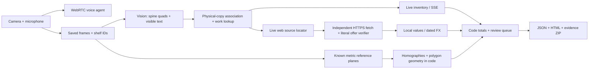

# Architecture note

**Voice:** OpenAI Realtime over browser WebRTC with server VAD and barge-in. Express exchanges SDP using a server-only key. Small image context plus backend inventory/guidance grounds speech; tools persist claimant corrections or select shelf IDs. Captions and transcripts are saved. HTTPS or localhost is required for devices.

**Recognition:** Responses (`OPENAI_VISION_MODEL`, default `gpt-6.1-terra`) extracts normalized quadrilaterals, visible text, confidence and capture defects. Current/previous same-shelf images support physical-copy tracking. Unreadable spines stay unidentified; duplicate titles are distinct copies. Independent stage outputs are persisted. Open Library corroborates a work; edition/ISBN need specific visual or attributed claimant evidence.

**Metric scale:** no model-written dimensions enter the packet. A known coplanar rectangle plus four saved-frame corners gives an eight-parameter homography. Transformed spine edges yield height/thickness and code sums thickness. Floors use complete polygons, walls use perimeter × uniform height, and shelving uses disjoint wall polygons. No frame/plane transfer or extrapolation beyond reference bounds. Unknown depth stays blank. Known/pre-existing room dimensions are an attributed fallback, not automatic monocular reconstruction.

**Prices:** a separate web-search model locates product URLs for a configurable market; its monetary guesses are ignored. Public-DNS-pinned HTTPS retrieval validates redirects and limits size/time. Product metadata must support identity, physical format, condition, availability and currency. Evidence retains URL, date, offer excerpt and page hash. Local offers are preferred; foreign amounts use saved dated Frankfurter FX. Unknown-model items need multiple comparables. Art/rare/signed/first/above-threshold objects require appraisal. Bot blocks or unsupported metadata yield empty values.

**Orchestration/output:** recognition and bounded pricing workers overlap during capture. A finalization abort budget limits post-sweep work; partial packets expose unresolved lines. SSE updates the browser. Currency minor-unit arithmetic creates totals. Deterministic review rules flag weak identity, missing scale/price, incomplete coverage and tracking ambiguity. JSON is authoritative; HTML renders from it. ZIP preserves frames, sources, stages, corrections and metrics with portable references. Atomic state snapshots recover sessions; interrupted work is flagged.

**Validation boundary:** fixture/API tests verify geometry, sums, provenance, corrections, adverse sources and exports. They establish no real-room recall, tape accuracy, mobile audio quality or actual sweep cost. Complete-room ground-truth tools and a one-take recorder support that required final evidence.
